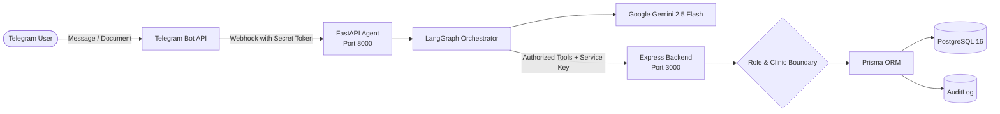

# AI Healthcare Receptionist (Telegram-Based AI Agent)

An autonomous, approval-led conversational healthcare receptionist operating on Telegram. Designed for small to medium clinics in India to handle patient appointments, doctor discovery, and approved clinic FAQs in **Hindi**, **English**, and **Hinglish**, while ensuring clinic managers maintain total editorial control over published clinic policies through document-to-draft extraction.

---

## 🌟 Key Features
- **Tri-Script Multilingual Interaction**: Seamless natural language understanding across English, Devanagari Hindi, and Romanized Hinglish (*"kal doctor se milna hai"*).
- **Strict Administrative Boundary**: 0 medical advice, diagnoses, or prescriptions. Medical emergency keywords immediately trigger 112/108 alerts.
- **Grounding on Approved Knowledge**: Answers patient inquiries strictly from manager-approved data. Unknown questions trigger staff escalation instead of AI hallucinations.
- **Explicit Human Confirmation**: 100% of bookings, cancellations, and reschedules require explicit user confirmation (`Yes/No` interrupt) before executing.
- **Zero Double-Booking Guarantee**: Transactional booking with partial unique database constraints on `(doctorId, startsAt) WHERE status = 'BOOKED'`.
- **Anti-Brute-Force Patient Verification**: Two-factor verification using booking code (`APT-XXXX`) and mobile number with a 3-attempt lockout and staff notification.
- **Document-to-Draft Pipeline**: Managers upload clinic policy PDFs/DOCXs. The agent extracts text (with Tesseract OCR for scans), parses rules, timings, and fees into a structured draft, surfaces gaps, and requires explicit manager approval before activating.

---

## 🏗️ Architecture



---

## 🚀 Quickstart & Setup

### 1. Prerequisites
- Node.js LTS (>= 20)
- Python 3.11+
- Docker Desktop (for PostgreSQL 16)
- Tesseract OCR (with `hin` and `eng` data) & Poppler
- ngrok (for public HTTPS Telegram webhook)

### 2. Environment Setup
Copy `.env.example` to `.env` and fill your credentials:
```bash
cp .env.example .env
```
*(Required: `TELEGRAM_BOT_TOKEN`, `LLM_API_KEY`).*

### 3. Start Database & Seed Demo Data
```bash
# 1. Start PostgreSQL
docker compose up -d

# 2. Install backend dependencies & seed demo clinic
cd backend
npm install
npm run db:deploy
npm run db:seed
```

### 4. Install Agent Dependencies
```bash
python3 -m venv agent/venv
source agent/venv/bin/activate
pip install -r agent/requirements.txt
```

### 5. Start Services & Webhook Tunnel
```bash
# Terminal 1: Backend server
cd backend && npm start

# Terminal 2: Agent server
source agent/venv/bin/activate
PYTHONPATH=agent uvicorn app.main:app --host 0.0.0.0 --port 8000

# Terminal 3: ngrok tunnel & webhook registration
ngrok http 8000
python agent/scripts/set_webhook.py
```

---

## 🧪 Running Automated Tests

### Backend Tests (Jest & Supertest - 24 Tests)
```bash
cd backend
npm test
```
*Covers: Health, auth, identity resolve, manager invite linking, clinic CRUD, cross-clinic isolation (403), doctor discovery, slot availability computation, booking transaction, double-booking prevention (409), patient verification & attempt limiting, cancellation, rescheduling, document draft approval, and escalations.*

### Agent Tests (Pytest & Asyncio - 36 Tests)
```bash
PYTHONPATH=agent agent/venv/bin/pytest agent/tests -v
```
*Covers: Webhook secret token validation, language detection (HI / EN / Hinglish), medical advice refusal, emergency detection (112/108 alert), prompt injection defense, document upload validation (size, MIME, magic bytes), DOCX/PDF text extraction, OCR fallback, LLM structured draft parsing, booking confirmation interrupt flow, and 18-case multilingual intent testbed.*

---

## 📱 Telegram Live Demo Walkthrough

Search for `@newton_receptionist_bot` on Telegram and try these interactions:

1. **Start Bot**: Send `/start` (see privacy notice and interactive menu).
2. **Find Doctor**: Click `[👨‍⚕️ Find a Doctor]` or ask *"I want to see a cardiologist tomorrow"*.
3. **Ask Timings (Hindi)**: Send *"क्लिनिक कब खुलता है?"*.
4. **Ask Fees (Hinglish)**: Send *"Dr Sharma ki fees kitni hai?"*.
5. **Medical Question (Refusal Test)**: Send *"mujhe bukhar hai kaunsi dawai lu?"* (bot refuses medication, offers appointment).
6. **Emergency Alert**: Send *"Patient has severe chest pain and unconscious"* (bot outputs 112/108 emergency warning).
7. **Book Appointment**: Click `[📅 Book Appointment]` -> Pick Doctor -> Date -> Slot -> Enter Name & Phone -> Confirm summary (`[Yes, Book It]`) -> Receive booking code `APT-XXXX`.
8. **Verify & Cancel**: Click `[📋 My Appointment]` -> Enter `APT-XXXX <phone>` -> Click `[❌ Cancel Appointment]` -> Confirm.
9. **Manager Document Flow**:
   - Send `/link MANAGER1` to link your Telegram account as Clinic Manager.
   - Upload any policy `.pdf` or `.docx`.
   - Bot previews extracted draft with detected gaps/conflicts.
   - Click `[✅ Approve & Activate]` to publish items to live patient Q&A!

---

## 📁 Repository Layout
```
backend/
  src/
    app.ts               # Express configuration, helmet, cors, rate limiting
    server.ts            # Entrypoint
    seed.ts              # Demo clinic, doctors, schedules, knowledge seed
    middleware/          # Service auth, role and clinic boundary checks, error handler
    routes/              # REST API routes (identity, clinics, doctors, appointments, drafts, escalations)
    services/            # Business logic and Prisma transactional system of record
    lib/                 # Prisma client, logger, custom error classes
  prisma/
    schema.prisma        # Multi-tenant PostgreSQL relational data model
  tests/                 # Jest integration tests
agent/
  app/
    main.py              # FastAPI webhook application & document upload handler
    config.py            # Environment settings
    graph/               # LangGraph state machine, nodes, and workflow
    telegram/            # Telegram Bot API client and typed models
    tools/               # Backend client and Pydantic tool schemas
    documents/           # PDF/DOCX extractor, OCR engine, and LLM structured draft parser
    prompts/             # Language detection and trilingual templates (EN/HI/Hinglish)
  tests/                 # Pytest test suites (webhook, safety, language, booking, documents)
docs/                    # SPEC, PRD, ARCHITECTURE, CONVERSATION_DESIGN, DECISIONS, PROGRESS, SECURITY_REPORT, CODE_REVIEW, FINAL_REPORT, DEMO_SCRIPT
```

---

## 📄 Compliance & Data Privacy
- Built strictly adhering to the **Digital Personal Data Protection (DPDP) Act 2023** of India.
- Minimizes patient data collection to Name and Phone Number only.
- Prohibits transmission or storage of diagnostic reports or medical records over Telegram.
