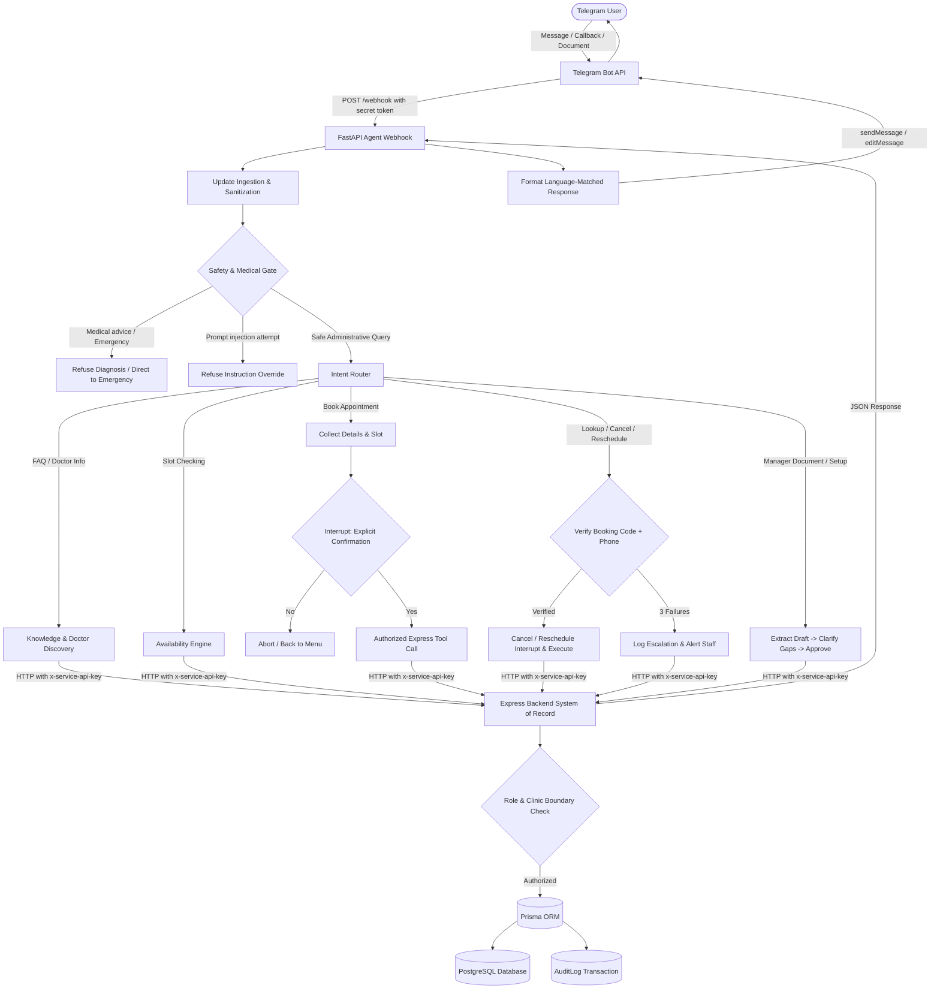
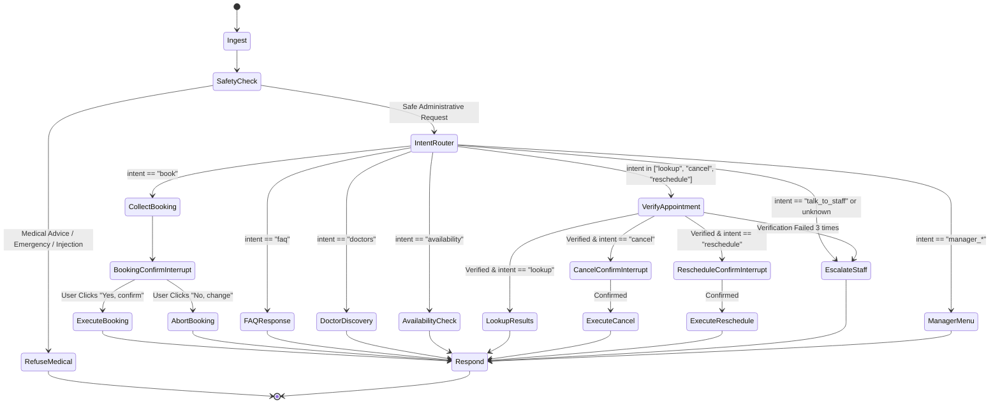

# ARCHITECTURE - AI Healthcare Receptionist

## 1. End-to-End Request Path



---

## 2. Service Responsibilities

| Service | Folder | Language / Framework | Core Responsibilities |
|---|---|---|---|
| **Backend** | `backend/` | Node.js (v24), TypeScript, Express, Prisma, Zod | System of record: auth, role and clinic boundary checks, doctor schedules, slot computation, transactional appointment booking, partial unique constraints (no double-booking), draft activation, audit logging. |
| **Agent** | `agent/` | Python 3.13, FastAPI, LangGraph, LangChain, Pydantic v2 | Webhook receiver, Telegram payload parsing, tri-script language handling (EN/HI/Hinglish), safety and medical refusal filters, conversational state machine with human-in-the-loop interrupts, document OCR and LLM draft extraction. |
| **Database** | Docker container | PostgreSQL 16 | Relational storage for clinics, doctors, schedules, appointments, knowledge items, drafts, escalations, and audit logs. |

---

## 3. Data Model (Prisma Schema Reference)

```prisma
datasource db {
  provider = "postgresql"
  url      = env("DATABASE_URL")
}

generator client {
  provider = "prisma-client-js"
}

enum Role {
  PATIENT
  MANAGER
  STAFF
}

enum AppointmentStatus {
  BOOKED
  CANCELLED
  COMPLETED
  RESCHEDULED
}

enum KnowledgeType {
  FAQ
  POLICY
  TIMING
  FEE
}

enum KnowledgeStatus {
  APPROVED
  ARCHIVED
}

enum DraftStatus {
  PENDING
  NEEDS_CLARIFICATION
  APPROVED
  REJECTED
}

enum EscalationStatus {
  OPEN
  RESOLVED
}

model Clinic {
  id           String          @id @default(uuid())
  name         String
  address      String
  phone        String
  email        String?
  timezone     String          @default("Asia/Kolkata")
  workingHours Json            // e.g. {"mon":{"open":"09:00","close":"18:00"}}
  isActive     Boolean         @default(true)
  createdAt    DateTime        @default(now())
  updatedAt    DateTime        @updatedAt

  users        User[]
  doctors      Doctor[]
  appointments Appointment[]
  knowledge    KnowledgeItem[]
  drafts       DocumentDraft[]
  escalations  Escalation[]
  inviteCodes  InviteCode[]
  auditLogs    AuditLog[]

  @@map("clinics")
}

model User {
  id           String          @id @default(uuid())
  clinicId     String?
  telegramId   String          @unique
  role         Role            @default(PATIENT)
  name         String?
  phone        String?
  createdAt    DateTime        @default(now())
  updatedAt    DateTime        @updatedAt

  clinic       Clinic?         @relation(fields: [clinicId], references: [id])
  appointments Appointment[]
  escalations  Escalation[]

  @@map("users")
}

model InviteCode {
  id         String    @id @default(uuid())
  clinicId   String
  code       String    @unique
  role       Role      @default(MANAGER)
  expiresAt  DateTime
  usedAt     DateTime?
  usedBy     String?
  createdAt  DateTime  @default(now())

  clinic     Clinic    @relation(fields: [clinicId], references: [id])

  @@map("invite_codes")
}

model Doctor {
  id              String        @id @default(uuid())
  clinicId        String
  name            String
  specialty       String
  consultationFee Float
  isActive        Boolean       @default(true)
  createdAt       DateTime      @default(now())
  updatedAt       DateTime      @updatedAt

  clinic          Clinic        @relation(fields: [clinicId], references: [id])
  schedules       Schedule[]
  leaves          DoctorLeave[]
  appointments    Appointment[]

  @@map("doctors")
}

model Schedule {
  id          String   @id @default(uuid())
  doctorId    String
  weekday     Int      // 0 = Sunday, 1 = Monday, ... 6 = Saturday
  startTime   String   // "09:00"
  endTime     String   // "13:00"
  slotMinutes Int      @default(30)

  doctor      Doctor   @relation(fields: [doctorId], references: [id], onDelete: Cascade)

  @@map("schedules")
}

model DoctorLeave {
  id        String   @id @default(uuid())
  doctorId  String
  date      DateTime @db.Date
  reason    String?

  doctor    Doctor   @relation(fields: [doctorId], references: [id], onDelete: Cascade)

  @@map("doctor_leaves")
}

model Appointment {
  id          String            @id @default(uuid())
  clinicId    String
  doctorId    String
  patientId   String
  patientName String
  patientPhone String
  startsAt    DateTime
  endsAt      DateTime
  status      AppointmentStatus @default(BOOKED)
  bookingCode String            @unique
  createdAt   DateTime          @default(now())
  updatedAt   DateTime          @updatedAt

  clinic      Clinic            @relation(fields: [clinicId], references: [id])
  doctor      Doctor            @relation(fields: [doctorId], references: [id])
  patient     User              @relation(fields: [patientId], references: [id])

  // Prevent double booking at the same start time for the same doctor when status is BOOKED
  @@unique([doctorId, startsAt], name: "doctor_slot_active_booking")
  @@map("appointments")
}

model KnowledgeItem {
  id         String          @id @default(uuid())
  clinicId   String
  type       KnowledgeType   @default(FAQ)
  question   String?
  content    String
  status     KnowledgeStatus @default(APPROVED)
  version    Int             @default(1)
  approvedBy String?
  approvedAt DateTime?
  createdAt  DateTime        @default(now())
  updatedAt  DateTime        @updatedAt

  clinic     Clinic          @relation(fields: [clinicId], references: [id])

  @@map("knowledge_items")
}

model DocumentDraft {
  id            String      @id @default(uuid())
  clinicId      String
  uploadedBy    String      // Telegram User ID
  fileName      String
  status        DraftStatus @default(PENDING)
  extractedJson Json
  issuesJson    Json?
  createdAt     DateTime    @default(now())
  updatedAt     DateTime    @updatedAt

  clinic        Clinic      @relation(fields: [clinicId], references: [id])

  @@map("document_drafts")
}

model Escalation {
  id           String           @id @default(uuid())
  clinicId     String
  userId       String?
  patientName  String?
  patientPhone String?
  reason       String
  summary      String
  status       EscalationStatus @default(OPEN)
  createdAt    DateTime         @default(now())

  clinic       Clinic           @relation(fields: [clinicId], references: [id])
  user         User?            @relation(fields: [userId], references: [id])

  @@map("escalations")
}

model AuditLog {
  id         String   @id @default(uuid())
  clinicId   String
  actorType  String   // "PATIENT" | "MANAGER" | "SERVICE"
  actorId    String   // Telegram user ID or service identifier
  action     String   // e.g. "CREATE_APPOINTMENT", "CANCEL_APPOINTMENT", "APPROVE_DRAFT"
  entity     String   // "Appointment", "KnowledgeItem", etc.
  entityId   String
  beforeJson Json?
  afterJson  Json?
  requestId  String?
  createdAt  DateTime @default(now())

  clinic     Clinic   @relation(fields: [clinicId], references: [id])

  @@map("audit_logs")
}
```

---

## 4. LangGraph Workflow Graph



---

## 5. Security & Isolation Invariants
1. **Model Output Never Authorizes Mutations**: LangGraph tool calls are treated as untrusted proposals. The Express backend evaluates authorization headers (`x-service-api-key`, `x-telegram-user-id`), role permissions, and clinic tenancy before applying any database mutation.
2. **Double-Booking Impossibility**: Prisma atomic transaction checks slot status and relies on PostgreSQL's unique index `doctor_slot_active_booking`. If another transaction acquires the slot milliseconds earlier, the second transaction fails immediately and cleanly with a concurrency conflict.
3. **Idempotency**: All booking requests carry an `Idempotency-Key`. Re-transmitting the exact same request will not create duplicate appointments.
4. **Data Minimization**: Patient state is limited to `patientName` and `patientPhone`. No medical diagnostic or symptom data is ever stored in tables or logged in text.
