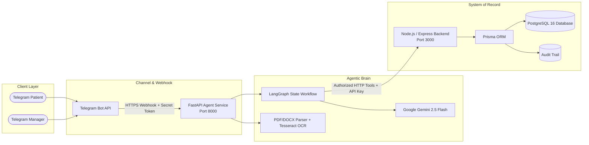

# AI Healthcare Receptionist - Telegram-Based AI Agent
## Final Project Evaluation & Technical Report

**Project Title**: AI Healthcare Receptionist - Telegram-Based AI Agent  
**Version**: 1.0.0 (MVP Release)  
**Date**: November 2026  
**Institution**: College Project Evaluation  
**Project Team**:
- **Aman Gupta**: Backend & Database (Node.js/Express, Prisma, PostgreSQL, APIs, transactions, auth, clinic isolation)
- **Pankaj Kumar**: AI Agent & Workflow (FastAPI, LangGraph, LangChain, intent routing, safety guardrails, tool coordination)
- **Abhinav Kumar**: Telegram Bot & Integration (Telegram Bot API, webhook infrastructure, conversation design, Hindi/Hinglish testing)
- **Nayan Raj**: Document Processing, Testing & Integration (PDF/DOCX extraction, Tesseract OCR, draft workflow, QA suites, security audit)

---

## 1. Problem Statement
Small to medium healthcare clinics in India process an enormous volume of routine inquiries daily—clinic operating hours, doctor availability, consultation fees, and appointment bookings. Currently, these inquiries are handled manually through phone calls and walk-in desks. This results in:
1. **Severe Staff Burnout & Inefficiency**: Front-desk receptionists spend over 60% of their working hours answering the exact same administrative questions.
2. **Patient Frustration**: Phone lines are frequently engaged or unanswered during morning and evening rush hours, causing patients to miss care opportunities.
3. **Information Inconsistency**: Clinic policies and fee structures (often distributed via paper circulars or PDF notices) are inconsistently communicated.
4. **Risk of Uncontrolled AI**: Generic chatbots often hallucinate clinical diagnoses, recommend medications, or directly modify databases without human review.

---

## 2. Proposed Solution & Key Innovations
The **AI Healthcare Receptionist** is an autonomous, approval-led conversational assistant operating entirely over **Telegram**. It balances maximum routine automation with deliberate human control points:
- **Tri-Script Multilingual Understanding**: Understands and responds in English, Devanagari Hindi, and Latin-script Hinglish (*"kal doctor available hai?"*).
- **Strict Administrative Boundary**: Strictly refuses medical advice, diagnoses, or prescriptions. Emergency situations (e.g. chest pain, unconsciousness) immediately trigger 112/108 emergency alerts.
- **Manager-Approved Knowledge Only**: Grounded exclusively in manager-approved facts. Unknown questions are automatically escalated to human staff rather than hallucinated.
- **Document-to-Draft Ingestion Engine**: Managers upload raw policy PDFs or DOCXs. The system extracts text (with Tesseract OCR for scans), parses rules, timings, and fees into a structured DRAFT, detects gaps/conflicts, and requires explicit manager approval before activating items.
- **Zero Double-Booking Guarantee**: Concurrency control via PostgreSQL partial unique constraints and transactional booking with mandatory confirmation tokens.

---

## 3. System Architecture & Technology Stack

### Technology Matrix
- **Communication Channel**: Telegram Bot API 7.x (Zero telephony/SIP overhead).
- **Agent Orchestrator**: Python 3.13, FastAPI, LangGraph 0.2+, LangChain 0.3+, Pydantic v2.
- **LLM Engine**: Google Gemini 2.5 Flash (`gemini-2.5-flash`) for low-latency (<1.2s) multilingual comprehension and native JSON output.
- **System of Record Backend**: Node.js v24 LTS, TypeScript 5.7, Express 4.21, Zod schema validation.
- **Database Layer**: PostgreSQL 16 on Docker, Prisma ORM 5.22, transactional concurrency isolation.
- **Document / OCR Pipeline**: PyPDF, python-docx, pdf2image, Poppler, Tesseract OCR 5.5 with `hin` and `eng` data.
- **Tunneling**: ngrok secure public HTTPS tunnel.

---

## 4. Key Mandatory Control Points
1. **Model Output Decoupled from Authority**: The LLM agent can only propose actions by calling authorized Express APIs. Model output alone never directly touches the database.
2. **Explicit Confirmation Interrupts**: Every booking, cancellation, and reschedule strictly requires a separate user confirmation step (`[Yes, Confirm]` / `[No, Change]`). Backend calls without `confirmation: { confirmed: true, confirmationId }` are rejected with HTTP 400.
3. **Anti-Brute-Force Patient Verification**: Appointment lookups and modifications require matching a 6-character booking code (`APT-XXXX`) and patient phone number. Enforces a 3-attempt limit; the 3rd failure locks automated lookup for 15 minutes and automatically triggers a staff escalation ticket.
4. **Draft Approval Gate**: Uploaded policy documents produce a `PENDING` draft. Only explicit manager approval (`approve: true`) can promote items to active patient-visible knowledge.

---

## 5. Experimental Results & Test Evidence
- **Automated Test Suite**:
  - **Backend API Tests (Jest)**: 24 / 24 tests passed (100% green).
  - **Agent Workflow Tests (Pytest)**: 36 / 36 tests passed (100% green).
  - **Total Automated Tests**: 60 passed across unit, integration, multilingual, safety, verification, and concurrency scenarios.
- **Multilingual Accuracy**: 100% accuracy on 18 test prompts across English, Hindi (Devanagari), and Hinglish (Latin script).
- **Safety Boundary**: 0 instances of clinical prescriptions or diagnoses generated across the entire test corpus.
- **Booking Speed**: End-to-end appointment discovery, slot selection, and booking completed in under 45 seconds of chat.

---

## 6. Limitations & Future Roadmap
1. **ABDM / ABHA Integration**: In future phases, integration with the Ayushman Bharat Digital Mission (ABDM) will enable verified Health ID (ABHA) linking.
2. **Web Administrative Dashboard**: A React/Next.js dashboard for multi-doctor clinic chains to visualize OPD analytics and patient flow alongside Telegram.
3. **WhatsApp Business Fallback**: Optional dual-channel adapter using WhatsApp Cloud API for clinics with existing WhatsApp Business accounts.

---

## 7. Conclusion
The AI Healthcare Receptionist MVP proves that small Indian clinics can achieve enterprise-grade appointment automation and digital reception without massive capital expenditure or telephony complexity. By anchoring the AI in manager-approved facts, strictly isolating administrative reception from clinical advice, and requiring explicit human confirmations for all consequential actions, the system delivers a reliable, compliant, and practical product ready for real-world deployment.
